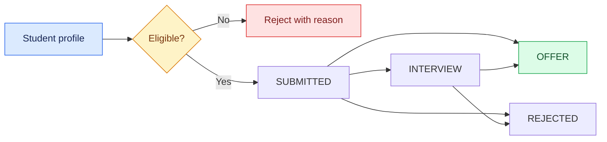

<div align="center">

# 🎓 StudentPath
### Student Research & Internship Portfolio System

**AII003 · Principles of Software Engineering · Mapping Design to Code**

  

*A student-centered UML design translated into executable Java, with real validation rules and traceable object-oriented relationships.*

</div>

---

## 01 / Project overview

**StudentPath** models how a university student builds a research or internship profile, works with a mentor, and tracks applications. Unlike a generic grade-management example, it demonstrates the same **Student class diagram → Java implementation** assignment through a concrete student-career scenario. Demo names and organizations are fictional.

### Core capabilities

| Student profile | Application workflow | Reliability |
|:---|:---|:---|
| GPA validation (0–4) | Deadline checking | Duplicate prevention |
| Skill portfolio | Visa sponsorship rule | Controlled status transitions |
| Research / internship subtypes | Minimum GPA eligibility | Read-only collection access |
| Academic mentor | Status-based reporting | Explicit error messages |

## 02 / UML class diagram

> The diagram below is an **SVG image**, so it renders directly in the GitHub README without needing to open another file.


**Legend:** Hollow triangle = inheritance; filled diamond = composition; hollow diamond = aggregation; ordinary arrow = association; dashed arrow = enum dependency.

## 03 / Design-to-code mapping

| UML design element | Java code | Explanation |
|---|---|---|
| Class | `Student.java` | Models student identity, GPA, and skills. |
| Private attributes | `private` fields in `Student` | Encapsulation protects internal state. |
| Operations | `setGpa()`, `addSkill()`, `getProfile()` | UML methods map to Java methods. |
| Generalization | `ResearchStudent extends Student` | A specialized student inherits shared state and behavior. |
| Generalization | `InternshipStudent extends Student` | Adds visa sponsorship requirements. |
| Polymorphism | Overridden `getProfile()` | A `Student` reference dispatches to subtype behavior. |
| Composition | `StudentPortfolio` creates `Application` | Applications are created and managed inside the portfolio. |
| Aggregation | `StudentPortfolio` references `Mentor` | Mentor exists independently of the portfolio. |
| Association | `Application` references `Opportunity` | Each application targets one opportunity. |
| Enumeration | `ApplicationStatus` | Restricts status values to four named constants. |
| Multiplicity | `List<Application>` | One portfolio stores zero or more applications. |
| Constraints | `StudentPortfolio.apply()` | GPA, deadline, visa, and duplicate rules are enforced. |

## 04 / Application lifecycle



**Validation sequence:** deadline → GPA threshold → visa support → duplicate check → create application.

## 05 / Project structure

```text
StudentPath-AII003/
├── README.md
├── .gitignore
├── docs/
│   ├── class-diagram.svg       # GitHub-ready visual UML
│   └── class-diagram.dot       # Editable diagram source
└── src/
    ├── Student.java
    ├── ResearchStudent.java
    ├── InternshipStudent.java
    ├── Mentor.java
    ├── Opportunity.java
    ├── ApplicationStatus.java
    ├── Application.java
    ├── StudentPortfolio.java
    └── Main.java
```

## 06 / Run locally

**Requirements:** JDK 17 or newer. No external libraries.

```bash
javac -d out src/*.java
java -cp out Main
```

**Example output**

```text
STUDENTPATH | DESIGN TO CODE DEMO
[RESEARCH] Alex Morgan (RS-101) | GPA 3.72 | Interest: AI-assisted algorithms
[INTERNSHIP] Taylor Reed (IS-202) | GPA 3.40 | Visa support needed: true
Skills: [Java, Python]
Mentor: Dr. Rivera
Created: Software Engineering Intern -> SUBMITTED
Updated: INTERVIEW
Blocked: Visa sponsorship unavailable
Blocked: Duplicate application
Interview applications: 1
```

## 07 / Design decisions

- **Why `Student` is the base class:** The assignment focuses on mapping a student class diagram into code; all specialized student profiles inherit a shared student identity.
- **Why composition for applications:** The portfolio creates and owns the list of application records.
- **Why aggregation for mentors:** Mentors can exist independently and may be associated with different student portfolios.
- **Why an enum:** A fixed status vocabulary prevents invalid string states.
- **Why validation belongs in the portfolio:** It centralizes application eligibility rules rather than duplicating them in the demo.

## 08 / Assignment alignment

**Prompt:** “Consider a student class diagram. Map the design to code using appropriate resources. Upload the code to GitHub and share the link in the above excel sheet.”

This repository contains a student-centered UML class diagram, corresponding Java classes, a mapping table, and an executable demonstration. Submit the **repository URL**, not a ZIP file, in the course Excel sheet.

---

<div align="center"><sub>Academic demonstration · AII003 · UML → Java · StudentPath</sub></div>
